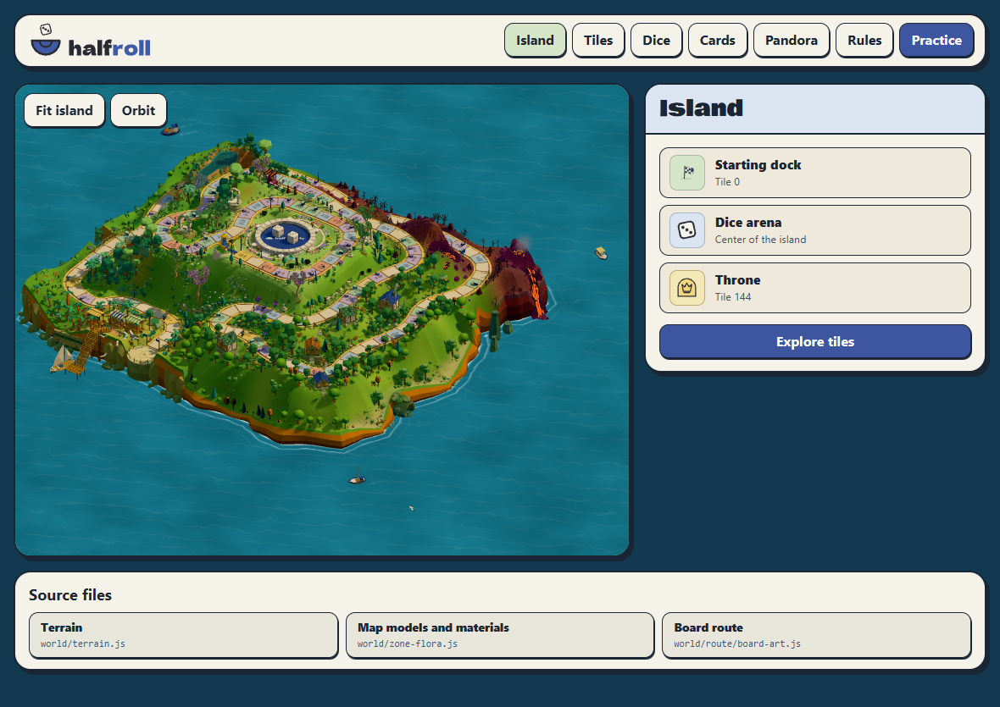

# Halfroll Workshop

Explore the 3D island, inspect every tile, roll the game’s dice, and play a local race from the starting dock to the throne.



[Screenshot gallery](docs/README.md)

## Run locally

Open a terminal in your clone and run this with Node.js installed.

```sh
npm start
```

Open the local URL printed by the server. Use **Island**, **Tiles**, **Dice**, **Cards**, **Pandora**, and **Rules** to explore. **Practice** starts a local race with bots. Enter a seed to replay a scenario.

Play a card effect in **Cards**, or pick an outcome or draw one in **Pandora**. Both use the island as a 3D stage and have a **Replay** button. Set **Light** or **Weather** from **Island** to carry the look into the other tabs.

## Find the source

| Change | Start here |
| --- | --- |
| Island terrain | [Terrain](world/terrain.js) |
| Route and tile appearances | [Route geometry](world/route/board-art.js) · [Tile key](world/tile-key.js) |
| Weather, daylight and atmosphere | [Weather](world/world-weather.js) · [Daylight](world/world-cycle.js) · [Atmosphere](world/world-atmosphere.js) |
| Scenery and vegetation | [Landmarks](world/landmarks.js) · [Plants and props](world/zone-flora.js) |
| Tile placement and card balance | [Board rules](game/board-rules/rules.js) |
| Dice model and motion | [Model](game/dice/pieces3d.js) · [Physics](game/dice/dice-motion.js) |
| Card illustrations | [Card art](assets/card-art/) |
| Pandora and turn flow | [Events](game/race-rules/rules.js) · [Race engine](game/race-rules/engine.js) |

The **Source files** panel opens the relevant code inside the Workshop. [The source index](workshop/source-index.json) records the game build and file layout.

## Suggest a change

Create a branch and open a small pull request. Include a screenshot or clip for a visual change, or a seed and steps to replay a rule change.

### First PR example — Pandora tile color

1. In [the tile key](world/tile-key.js), try `#e5bded` as the `color` for `pandora`. This color applies to every Pandora tile.
2. Reload the local Workshop. Open **Tiles**, select **10**, and check the new color on the board and in the tile inspector.
3. Open a PR titled `Adjust the Pandora tile color` and attach before and after screenshots of tile 10.

The local build runs offline. It uses Supreme if installed locally and otherwise uses your system font. [Font credits](assets/fonts/CREDITS.md).
